# OpenTennis — a remaster of Hot Shots Tennis (PS2)

A from-scratch rewrite of the PlayStation 2 game **Hot Shots Tennis** (US, 2007), known as **Everybody's Tennis**
in Europe and **Minna no Tennis** (みんなのテニス) in Japan, in Rust with the [Bevy](https://bevyengine.org) engine.
The goal is the same game: the same ball physics, rules, timing and AI, ported from the original and checked
frame by frame against the real game, with better rendering on top.

**Play in your browser: <https://opentennis.dev>** (you pick your own ISO; nothing is uploaded).

Newest unreleased build (every change to main, less tested): <https://beta.opentennis.dev>.

**Download** for Windows, Linux, Android or iOS: [latest release](https://github.com/FIZL0/opentennis/releases/latest).

**iPhone / iPad:** [add the source in one tap](https://opentennis.dev/ios.html) to Feather, AltStore or SideStore, or add
`https://github.com/FIZL0/opentennis/releases/latest/download/altstore-source.json` under Sources. You sign it
with your own certificate, and updates arrive through the app.

Work in progress. Building from source, modding by hand and development: [docs/DEVELOPING.md](docs/DEVELOPING.md).

## Screenshots

Taken from the remaster running on a retail disc (the art comes from the disc; none of it is in this repository).

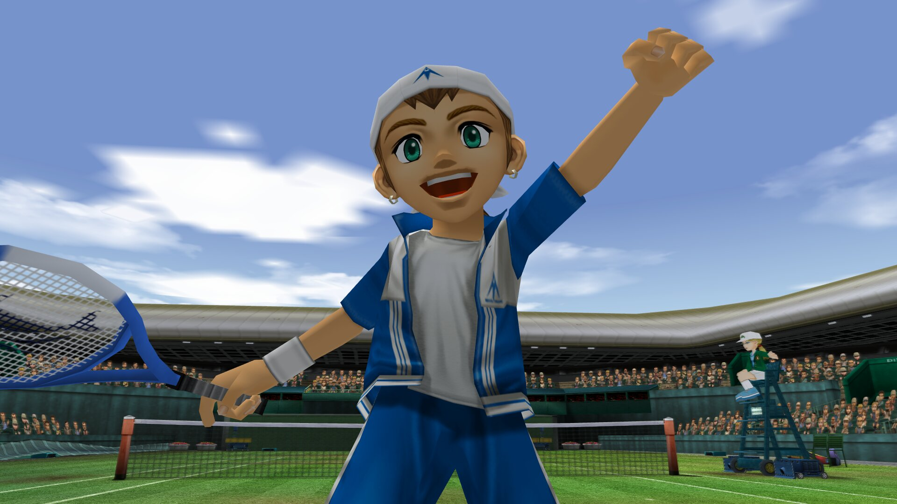

| | |
|---|---|
| 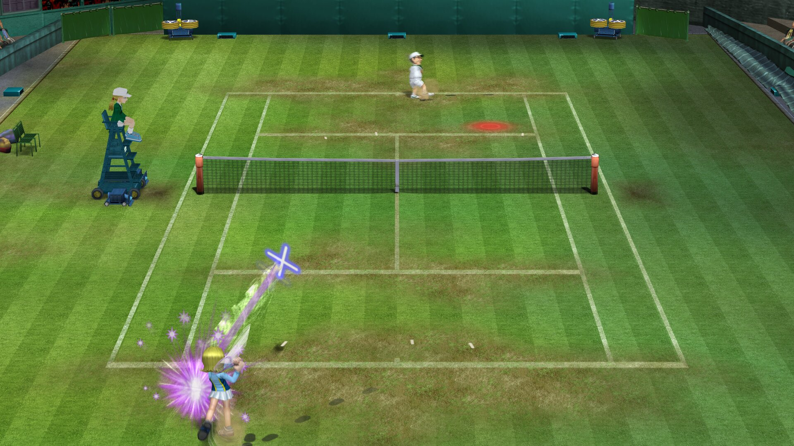 |  |
|  | 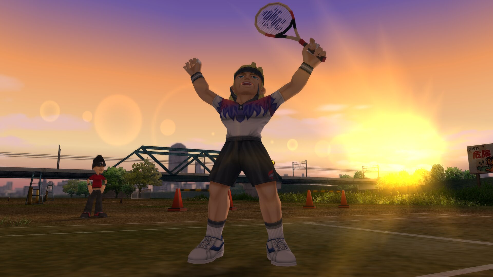 |
| 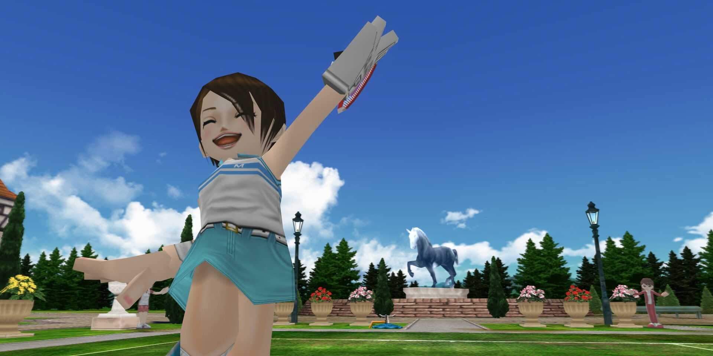 | 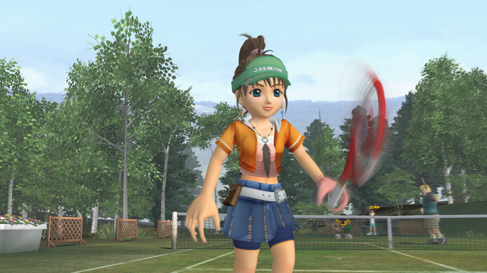 |
| 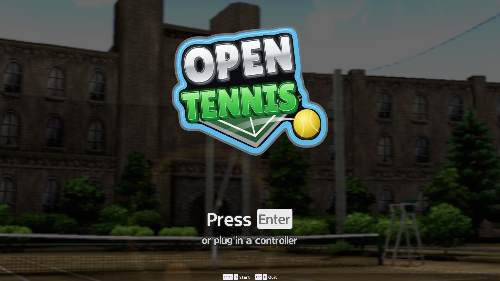 |  |
| 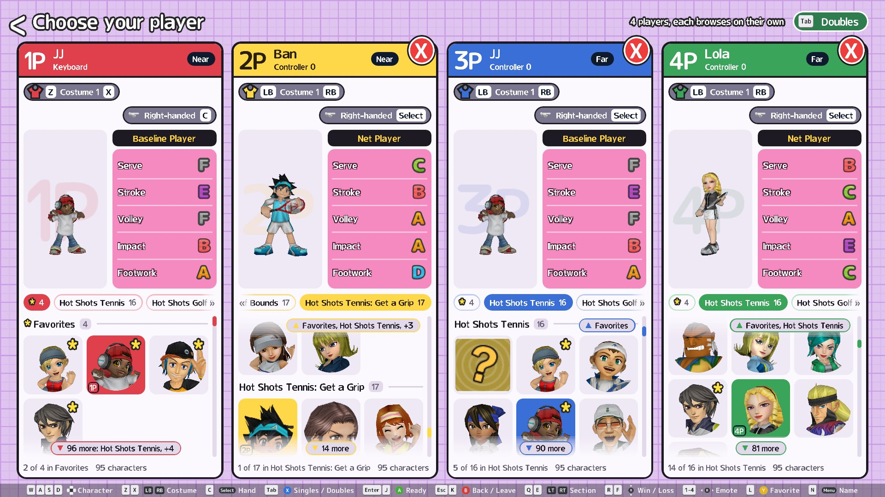 |  |
| 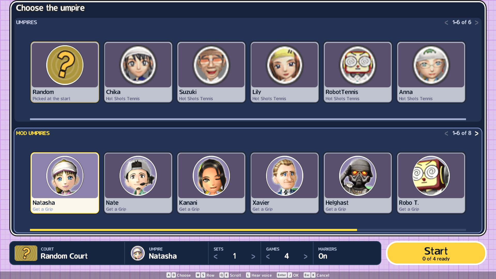 | 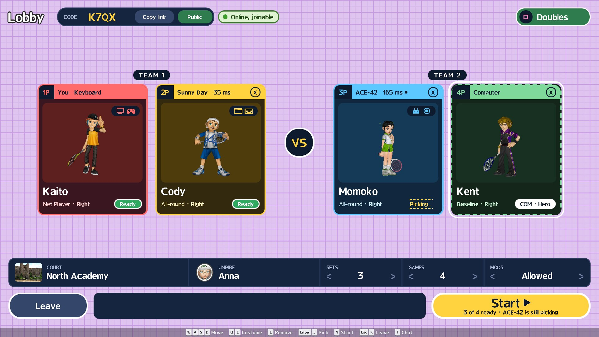 |
| 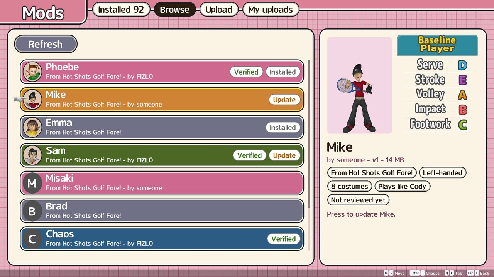 | 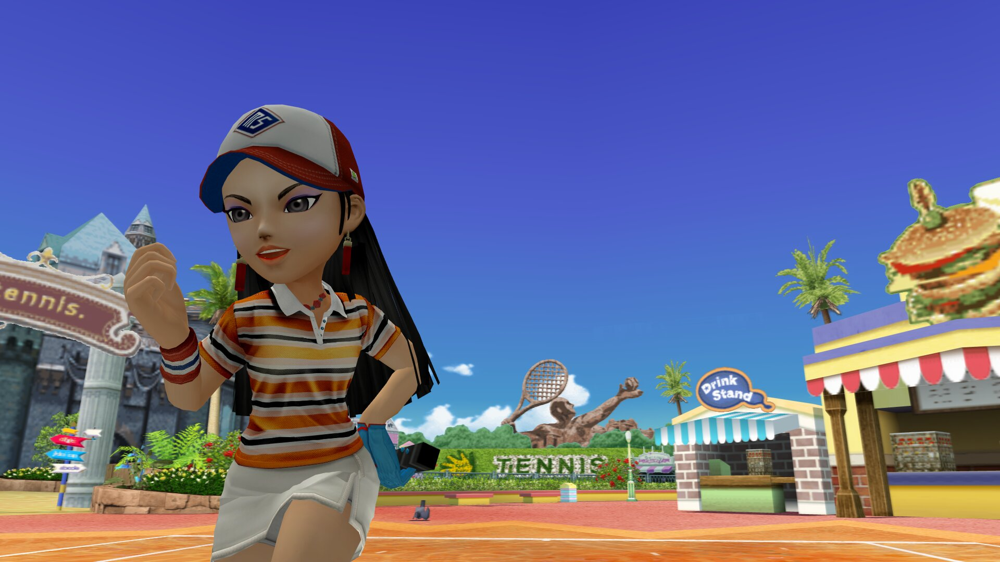 |

## You must provide the game disc

**This repository contains no game data**: no models, textures, animations, sounds, music or program code from the
original. Everything the game shows or plays is read **at runtime from your own copy of the disc**. Without it,
nothing runs.

What you need:

| | |
|---|---|
| **Disc** | Hot Shots Tennis, **US release, version 1.00, serial SCUS-97610** (PS2) |
| **Format** | A disc image (`.iso`) you made from **a disc you own** |
| **Where** | Anywhere; the game asks for it the first time (the browser keeps it in private storage, nothing is uploaded) |

- **Other regions don't work.** Everybody's Tennis (Europe), Minna no Tennis (Japan) and other versions have
  different program data. The game checks the disc (`SYSTEM.CNF` boot file `SCUS_976.10` and the size and header of
  `ZZBIN/GAME.BIN`) and refuses anything else with `unsupported disc`.
- **Don't ask for, share or commit disc images or anything extracted from them.** Nobody here can provide one.
- **You don't need a PS2 BIOS, an emulator or any other files** to play. Those are only for the research tools
  (see [docs/DEVELOPING.md](docs/DEVELOPING.md)).

## What works, what's missing

**Plays like the original** (checked against recordings of the real game, frame for frame): ball flight, spin,
bounces and the court, net, walls and props it hits; every shot (topspin, slice, lob, flat, drop, smash, serve),
timing grades and each character's own shot data, reach and dives; the CPU players in singles and doubles; line
calls, scoring, change of ends and the timing between points; weather and the courts' moving creatures.

**Ours, made to look and feel right:** rendering (any resolution and aspect ratio, uncapped frame rate, upscaled
texture packs), menus, settings, online play with rollback, touch controls, character/court/umpire/texture mods.

**Not there yet:**
- The original's second match camera, Set Handicap and Offbeat Rules.
- Let serves aren't proven against the real game yet.
- Shadows are sharper than the PS2's in the "Original" look.

The open list is [plan/TODO.md](plan/TODO.md); how it's made and what it's built on: [CREDITS.md](CREDITS.md).

## Controls

Player 1 uses the keyboard or the first controller. In doubles, a second controller plays player 1's partner (P1 + P2
vs 2 CPUs); in singles it plays the opponent. Every other player is a CPU.

| Action | Keyboard | Controller |
|---|---|---|
| Move (aim while swinging) | WASD | Left stick / d-pad |
| Topspin | J | A |
| Slice / Serve | K | B |
| Lob | L | Y |
| Drive | U | RB |
| Swap hand (character select) | C | Select |

## Mods

Main menu → Mods adds characters, courts and umpires from the store
([`FIZL0/opentennis-mods`](https://huggingface.co/datasets/FIZL0/opentennis-mods)), on desktop and in the browser.

- **Browse mods**: pick one to install it.
- **Upload my mod**: sign in with a Hugging Face *Write* token, then pick a mod to upload. It shows as
  *Not reviewed* until merged.
- **Made your own?** Put its folder (`mod.json` + `.glb` files) in `mods/<id>/` in the game's data folder (`~/.local/share/hst`, `%APPDATA%\hst`, `~/Library/Application Support/hst`); it shows in the
  game and in Upload my mod. How to make one: [opentennis-mods](https://github.com/FIZL0/opentennis-mods).

Texture replacements: texture packs (a mod whose `mod.json` says `"kind": "textures"`; several stack in an order) and
`mods/texture-replacements/` replace the disc's textures, a PCSX2 texture pack made for the original game works as is, and
mods can carry upscaled textures of their own (the "Texture Replacements" setting). How to make either: [docs/DEVELOPING.md](docs/DEVELOPING.md).

## Online play

Main menu → Online. Up to four players, singles or doubles; the computer plays any open seat. Browser, desktop and
phone players can all play together.

- **Host** opens a lobby with a 4-letter code. Public lobbies are listed in **Find** and picked up by **Quick play**;
  Private ones only take the code or link.
- **Join** takes the code, or the host's copied link (opening the link joins too).
- Players connect directly where they can; otherwise traffic goes through a relay (iroh's public ones by default, or
  your own: Online → Relay → Custom...).
- Codes are looked up through our code server, `pkarr.opentennis.dev`. If it's down the game switches to the public
  `relay.pkarr.org` by itself; that one is rate-limited per network, so a house full of players can hit "no answer".

**Same network, no internet** (Relay → Off):

- Desktop and phone apps find each other's lobbies in Find.
- Browsers can't see the local network, so there's no code: the host copies their link (Copy link) and sends it;
  the guest opens it or taps **Paste** in Join by Code, then copies their own link back, and the host taps **Paste**
  in the lobby. On iOS Safari, tap Paste a second time if it asks.

**Host your own servers.** Nothing is required, but you can run both servers yourself:

- *Code server* (short codes, Find): [tools/pkarr-relay/](tools/pkarr-relay/) has a Docker Compose file (works as a
  TrueNAS custom app) and an nginx config. Put it behind HTTPS on your domain, then add
  `code_server = https://your.domain` to `online.txt` in the data folder on each player. Codes go into the same public
  DHT either way, so players on different code servers still find each other.
- *Relay* (traffic when a direct path fails): `iroh-relay`, see [docs/DEVELOPING.md](docs/DEVELOPING.md). Every
  player in a lobby needs the same relay.

More (settings file, terminal client): [docs/DEVELOPING.md](docs/DEVELOPING.md).

## License

The code is licensed under either of [Apache License 2.0](LICENSE-APACHE) or [MIT](LICENSE-MIT), at your option.
This covers the code only, not the game or its data.

## Legal

This is an unofficial fan project, not affiliated with or endorsed by Sony Interactive Entertainment or Clap
Hanz. Hot Shots Tennis, Everybody's Tennis and Minna no Tennis are trademarks of their owners. No copyrighted game
data is included or distributed. You must own the game to use this.
